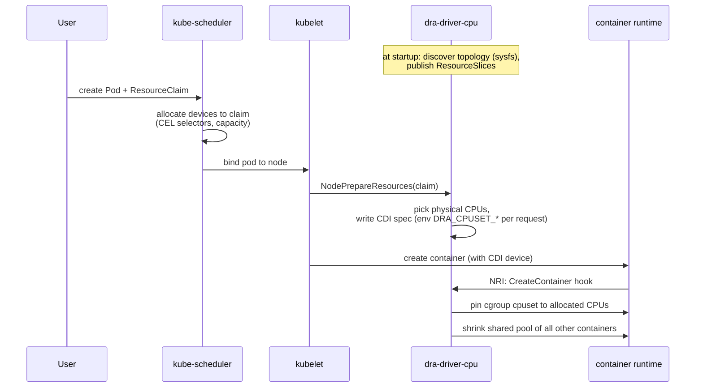

# How it Works

The driver is deployed as a DaemonSet. A single executable implements the DRA
and NRI interfaces, and it owns the node-local CPU allocation state.
Exactly one active driver instance is expected to manage each node.
Without [CPU partitions](cpu-partitions.md), the driver manages all the
available CPUs except those configured as reserved, as a single pool. With
them, each partition's role decides which CPUs claims and containers without
claims use.
The singleton invariant is not currently enforced by the driver and must be
guaranteed by the deployment.

The lifecycle of a claim, from pod creation to a pinned container:

The two components in detail:

- **DRA driver**: This component is the main control loop and handles the interaction with the Kubernetes API server for Dynamic Resource Allocation.

  - **Topology Discovery**: It discovers the node's CPU topology, including details like sockets, NUMA nodes, cores, SMT siblings, Last-Level Cache (LLC), and core types (e.g., Performance-cores, Efficiency-cores). This is done by reading sysfs files.
  - **ResourceSlice Publication**: Based on the `cpuDeviceMode` configuration field, it publishes `ResourceSlice` objects to the API server:
    - In `grouped` mode (default), devices represent larger CPU aggregates (like NUMA nodes or sockets). These devices support consumable capacity, indicating the number of available CPUs within that group.
    - In `individual` mode (deprecated), each allocatable CPU becomes a device in the `ResourceSlice`, with attributes detailing its topology.
      This mode is not recommended for new deployments. See [this document](opaque-cpuset-overrides.md#migrate-from-individual-mode) to migrate existing deployments.
  - **Claim Allocation**: When a `ResourceClaim` is assigned to the node, the DRA driver handles the allocation:
    - In `grouped` mode (default), the claim requests a *quantity* of CPUs from the group device. The driver then uses topology-aware allocation logic (imported from [Kubelet's CPU Manager](https://github.com/kubernetes/kubernetes/blob/v1.35.0/pkg/kubelet/cm/cpumanager/cpu_assignment.go)) to select the physical CPUs within the group. Strict compatibility with kubelet's cpumanager or CPU allocation is not a goal of this driver. This decision will be reviewed in the future releases.
    - In `individual` mode (deprecated), the scheduler has already selected specific CPU devices. The driver enforces this selection through CDI and NRI.
  - **CDI Spec Generation**: Upon successful allocation, the driver generates a CDI (Container Device Interface) specification.

- **CDI (Container Device Interface)**: The driver uses CDI to communicate the allocated CPU set to the container runtime.

  - A CDI JSON spec file is created or updated for the allocated claim. It holds one device for each request of the claim and, in one of its annotations, the CPUs each request was given, so that one write of the file replaces both.
  - Each device instructs the runtime to inject the environment variable `DRA_CPUSET_<claimUID>_<request>=dynamic` into the containers that name its request, or that name the claim without a request. The value is always `dynamic`: the variable tells the driver which claim and request a container holds, and the driver takes the CPUs from its own record.
  - The `DRA_CPUSET_*` environment variable prefix is reserved for the driver. Containers with malformed `DRA_CPUSET_*` values are rejected during creation.
  - The driver includes mechanisms for thread-safe and atomic updates to the CDI spec files.

- **NRI Plugin**: This component integrates with the container runtime via the Node Resource Interface (NRI).

  - For containers with **guaranteed CPUs** (those with a DRA ResourceClaim), the plugin takes the claims and requests a container holds from the variables injected via CDI, and pins the container to the CPUs the driver's record gives those requests using the cgroup cpuset controller. A container uses a claim whole: one that names some but not all of a claim's requests is rejected during creation.
  - For all other containers, it confines them to a **shared pool** of CPUs, which consists of all allocatable CPUs not exclusively assigned to any guaranteed container.
  - It dynamically updates the shared pool cpuset for all shared containers whenever guaranteed allocations change (containers are created or removed).
  - On restart, the driver restores the record of every claim from the CDI specs it wrote before it registers with the kubelet, so a claim whose container does not exist yet keeps its CPUs, and the NRI plugin pins a container only to the claims those records show it holds. A claim that fails that check is not given to the container, which runs on the shared CPUs if it holds no other claim, and the refusal is logged and counted. A running container that names some but not all of a claim's requests keeps the whole claim where the runtime shows it pinned to exactly the CPUs of its claims, and is counted in `dra_cpu_containers_kept_under_older_rule_total`; it is rejected when it is created again.
  - The driver registers with the kubelet only once the NRI plugin has first synchronized and the driver has read its Node. While the NRI plugin is not connected to the container runtime afterwards, from a lost connection until it has reconnected and synchronized, the driver refuses to prepare claims and the kubelet retries the preparation later. Unpreparing a claim is never refused.
